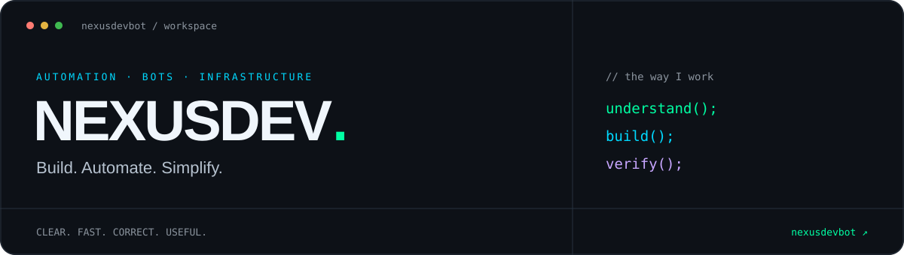

**Bot Telegram · Otomasi · Infrastruktur Linux**

## Tentang saya

Saya **NEXUSDEV**. Saya membangun perangkat lunak untuk mengurangi pekerjaan berulang dan membuat layanan lebih mudah dikelola—mulai dari bot Telegram dan integrasi API sampai otomasi server Linux.

Prinsip kerja saya: pahami masalahnya, buat solusi yang sederhana, lalu uji hasilnya.

## Proyek pilihan

| Proyek | Fokus |
| :--- | :--- |
| [**API Downloader**](https://github.com/nexusdevbot/apidownloader) | API pengunduh media dan dokumen dengan JavaScript. |
| [**BotVPN**](https://github.com/nexusdevbot/BotVPN) | Bot Telegram untuk pengelolaan dan penjualan layanan VPN. |
| [**Auto Installer Marzban**](https://github.com/nexusdevbot/auto-installer-mazban) | Otomasi instalasi panel Marzban dan konfigurasi layanan. |
| [**nexus-stress**](https://github.com/nexusdevbot/nexus-stress) | Perangkat uji beban dengan metrik dan pembatasan target. |

## Perangkat kerja

<picture>
  <source media="(prefers-color-scheme: dark)" srcset="https://skillicons.dev/icons?i=python,nodejs,javascript,typescript,linux,bash,cloudflare,git,nginx&amp;perline=9&amp;theme=dark" />
  
</picture>

## Aktivitas GitHub

<picture>
  <source media="(prefers-color-scheme: dark)" srcset="https://github-profile-summary-cards.vercel.app/api/cards/profile-details?username=nexusdevbot&amp;theme=tokyonight" />
  
</picture>

<strong>Statistik tambahan</strong>

 

<picture>
  <source media="(prefers-color-scheme: dark)" srcset="https://github-profile-summary-cards.vercel.app/api/cards/repos-per-language?username=nexusdevbot&amp;theme=tokyonight" />
  
</picture>

## Terhubung

Untuk pertanyaan, ide kolaborasi, atau otomasi: **[Telegram @nexusweb_dev](https://t.me/nexusweb_dev)**.
