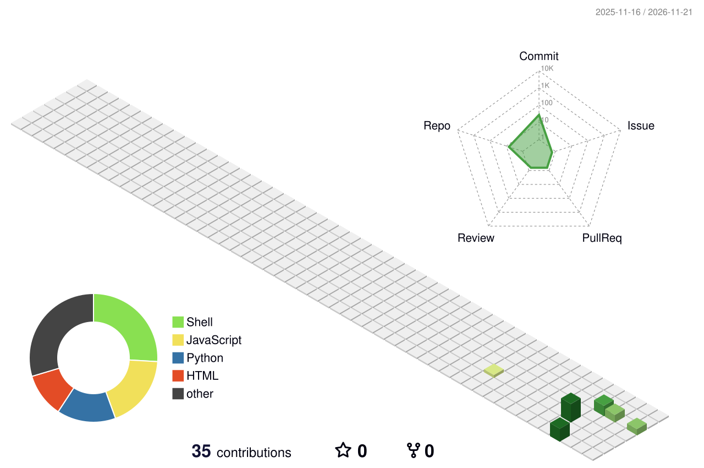

### Kode yang berguna. Proses yang lebih sederhana.

Membangun bot, otomasi, dan infrastruktur untuk menyelesaikan pekerjaan nyata.

[Profil](#tentang-saya) · [Teknologi](#teknologi) · [Aktivitas](#aktivitas) · [Kontak](#mari-terhubung)

## Tentang saya

Saya **NEXUSDEV**, pengembang yang senang menghubungkan kode dengan kebutuhan sehari-hari. Fokus saya ada pada **bot Telegram**, **otomasi alur kerja**, dan **pengelolaan infrastruktur Linux**.

Saya suka solusi yang mudah dipahami, bisa diuji, dan praktis digunakan. Kalau sebuah pekerjaan berulang, saya mencari cara agar kode yang menanganinya.

| Bidang | Yang saya kerjakan |
| :--- | :--- |
| **Bot & integrasi** | Bot Telegram, integrasi API, dan layanan pendukung. |
| **Otomasi** | Alur kerja untuk mengurangi tugas manual yang berulang. |
| **Infrastruktur** | VPS Linux, layanan server, dan Cloudflare Workers. |
| **Eksperimen** | Menjelajahi perangkat AI dan cara menghubungkannya ke aplikasi. |

## Teknologi

Perangkat yang mendukung pekerjaan saya, dari skrip sampai layanan server.

<picture>
  <source media="(prefers-color-scheme: dark)" srcset="https://skillicons.dev/icons?i=python,nodejs,javascript,typescript,linux,bash,cloudflare,git,nginx&amp;perline=9&amp;theme=dark" />
  
</picture>

## Aktivitas

Ringkasan kontribusi publik di GitHub. Grafik diperbarui oleh layanan statistik dan alur kerja repositori ini.

<picture>
  <source media="(prefers-color-scheme: dark)" srcset="https://github-profile-summary-cards.vercel.app/api/cards/profile-details?username=nexusdevbot&amp;theme=tokyonight" />
  
</picture>

<strong>Lihat statistik & bahasa pemrograman</strong>

 

<picture>
  <source media="(prefers-color-scheme: dark)" srcset="https://github-profile-summary-cards.vercel.app/api/cards/stats?username=nexusdevbot&amp;theme=tokyonight" />
  
</picture>
<picture>
  <source media="(prefers-color-scheme: dark)" srcset="https://github-profile-summary-cards.vercel.app/api/cards/repos-per-language?username=nexusdevbot&amp;theme=tokyonight" />
  
</picture>

### Jejak kontribusi

<picture>
  <source media="(prefers-color-scheme: dark)" srcset="https://raw.githubusercontent.com/nexusdevbot/nexusdevbot/output/github-snake-dark.svg" />
  
</picture>

<strong>Jelajahi kontribusi dalam 3D</strong>

 

<picture>
  <source media="(prefers-color-scheme: dark)" srcset="https://raw.githubusercontent.com/nexusdevbot/nexusdevbot/output/profile-3d-contrib/profile-night-rainbow.svg" />
  
</picture>

## Mari terhubung

Punya ide, ingin membahas otomasi, atau tertarik bekerja sama? Sapa saya di **[Telegram — @nexusweb_dev](https://t.me/nexusweb_dev)**.

---

<strong>NEXUSDEV</strong> · Pahami masalahnya. Bangun solusinya. Uji hasilnya.

